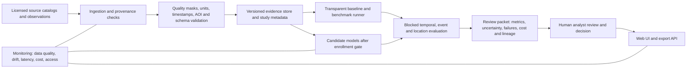

Warning: truncated output (original token count: 6415)
Total output lines: 156

# ATLAS AI Systems and Longevity Blueprint

**Status:** strategic proposal for ATLAS; not a production-readiness claim  
**Research checked:** 8 November 2026  
**Primary category:** trustworthy, evidence-first geospatial decision-support engineering  
**Purpose:** establish a maintainable path from the current research demo to independently validated, useful, and supportable water-exposure screening.

## Executive direction

ATLAS fits best in **trustworthy geospatial decision support**. Data engineering, statistical science, machine learning, human factors, and cloud systems are supporting disciplines inside that category. Neuroscience is a research input for human-AI interaction and possible computational ideas; it is not a reason to make the product “brain-like.”

The durable next step is to strengthen the **evidence and release system before adding predictive AI**. Freeze a common data contract and evaluation protocol; acquire authorized, quality-checked observations and independent reference labels; establish simple baselines; then compare candidate methods on the same held-out events and places. A model is promoted only if it improves a predeclared decision metric and remains calibrated, reliable, affordable, interpretable enough for its use, and maintainable.

ATLAS is currently an owner-only web demonstration with synthetic analysis fixtures and candidate study-area evidence. The latest project audit (4 November 2026) records 0/16 confirmatory areas, missing target-product pixel access/independent labels, and unresolved cloud account and billing inputs. Those are gates to future evidence and provider deployment; a literature review or model benchmark cannot substitute for them. The project scorecard remains provisional at 60/100.

## What the named universities contribute

These sources offer different kinds of evidence: peer-reviewed methods, institutional research programs, and applied projects. They are not equivalent, and none implies university endorsement of ATLAS.

| Institution | Relevant work | Evidence type and ATLAS implication |
|---|---|---|
| **MIT** | [Pre-deployment reliability assessment for general-purpose AI models](https://news.mit.edu/2024/how-assess-general-purpose-ai-models-reliability-its-deployed) | Research reporting on estimating model reliability before deployment. Treat model selection as an empirical gate; do not infer reliability from model size or a single aggregate benchmark. |
| **Stanford** | [Measuring and Mitigating (Over)reliance to Build Human-Compatible AI](https://ojs.aaai.org/index.php/AIES/article/view/43225) (AIES 2026; authors include Stanford, Oxford, and MIT affiliations) | Peer-reviewed human-AI reliance research. Measure whether analysts appropriately accept, reject, or escalate model advice; user trust is not the same as model correctness. |
| **Carnegie Mellon** | [Trustworthy autonomous systems resources](https://www.sei.cmu.edu/developing-trustworthy-autonomous-systems-resources) | SEI research and engineering resources emphasize purposeful data curation and system context. Document labels, provenance, target conditions, and operating limits before model training. |
| **UC Berkeley** | [AI-supported snowmelt forecasting for water scarcity and flood planning](https://dse.berkeley.edu/programs/addressing-climate-caused-water-scarcity) | Applied program evidence, not a transferable benchmark. It illustrates that reliable climate decision support depends on local practices, expert knowledge, and accessible data as well as the model. |
| **National University of Singapore (NUS)** | [CondensNet: stable long-term hybrid climate simulations with adaptive physical constraints](https://www.nature.com/articles/s41612-025-01269-5) (npj Climate and Atmospheric Science, 2026) | Peer-reviewed hybrid deep learning research. Encode physical or domain constraints when justified, and test long-run stability; physics constraints do not remove the need for site-specific validation. |
| **Nanyang Technological University (NTU)** | [NEWRI modelling and AI research](https://www.ntu.edu.sg/newri/research-focus/modelling-and-artificial-intelligence-(ai)) and [water research](https://www.ntu.edu.sg/about-us/sustainability/research-domains/water) | Institutional program evidence for modelling, sensing, water and wastewater management. Treat sensors, domain models, and operational decisions as one measured workflow. |
| **University of Oxford** | [Challenges and opportunities of ML and explainable AI in large-sample hydrology](https://ora.ox.ac.uk/objects/uuid:c5f0a1b0-1de9-4370-8dff-9116c633d2f1) (2025) | Hydrology-focused review/perspective. Align methods and explanations with hydrologic data, sampling, and the decision; explanations do not establish causal validity. |
| **Tsinghua University** | [NeuroAI Lab research direction](https://collegeai.tsinghua.edu.cn/en/Research/Research_Groups/NeuroAI_Lab__AI___Neuroscience_.htm) | Official lab description, not a comparative performance study. It identifies computational neuroscience, interpretable neural models, and brain-computer interfaces as research areas; use as a research lead, not proof that a neural architecture is best for ATLAS. |
| **University of Birmingham / Birmingham Dubai** | [2026 review on AI and complex water-quality challenges](https://research.birmingham.ac.uk/en/publications/diving-into-ai-exploring-the-potential-for-ai-to-tackle-complex-w) and [Dubai research themes](https://www.birmingham.ac.uk/dubai/research) | The review highlights AI-ready data and clear open examples as adoption needs. The Dubai page lists AI, behavioural science, engineering, and water/logistics themes. The water-quality review is university-wide; it is not attributed here to the Dubai campus. |

### Neuroscience and AI: two separate questions

1. **NeuroAI / brain-inspired computation:** neuroscience can suggest hypotheses about memory, temporal dynamics, representation, and learning. Such ideas should enter ATLAS only as testable candidates with matched data, compute, and baselines. Biological inspiration alone is not evidence of higher accuracy or reliability.
2. **Human neuroscience and AI reliance:** people can over-trust or under-trust decision support. Study analyst performance, appropriate reliance, workload, and error recovery with representative users. Do not use brain signals or clinical inference in ATLAS without a specific justified use, ethics review, consent, and data governance.

Recent cross-institution work on human-AI reliance informs the interface and review process; it does not establish that any one display or confidence score will calibrate trust in ATLAS users. Test the actual workflow.

## Model portfolio: fit the method to the evidence

“Highest performance” means the best predeclared performance for a specific decision under its data, latency, cost, and failure constraints. There is no model class that is best for every task. Compare against a transparent baseline and use grouped, time-aware splits so nearby pixels, repeated assets, or the same storm do not leak across train and test sets.

| Method | What it is designed to do | Strong fit | Main limits and release checks |
|---|---|---|---|
| **Statistical models** (for example, linear/logistic regression, generalized linear models, time-series models) | Estimate interpretable associations, rates, trends, and forecasts under explicit assumptions | First benchmark; small or structured datasets; operationally understandable effects | Check assumptions, residuals, missingness, confounding, calibration, and drift. Association is not causal impact. |
| **Random Forest** | Combine many decorrelated decision trees for tabular classification or regression | Nonlinear interactions and mixed feature types; strong, low-friction tabular baseline | Does not extrapolate reliably beyond training support; can be large; feature importance can mislead. Use held-out event/site tests and calibrated probabilities if probabilities affect decisions. |
| **K-Nearest Neighbors (KNN)** | Predict from nearby examples under a chosen distance metric | Small datasets where local similarity is meaningful; simple retrieval or baseline checks | Normalize features and justify the distance metric. High-dimensional features weaken neighborhood meaning; inference and storage grow with reference data. |
| **Probabilistic and Bayesian methods** | Represent uncertainty, encode defensible prior knowledge, and update beliefs as evidence arrives | Sparse observations, uncertainty-sensitive triage, hierarchical differences across areas | Make priors explicit; assess sensitivity and calibration. A narrow posterior is not proof the prior or data are correct. Consider ensembles or conformal intervals as comparisons, not magic guarantees. |
| **Support Vector Machines (SVMs)** | Find maximum-margin boundaries, with kernels for selected nonlinear decision surfaces | Medium-sized, high-dimensional feature sets where margins generalize well | Feature scaling and tuning matter; kernel methods can become costly at scale. Probability outputs require separate calibration. |
| **Symbolic regression** | Search for compact equations that fit observed input-output relationships | Candidate physical or operational relationships that should be inspectable and testable | Search can overfit, be unstable, or violate units and known constraints. Constrain the grammar/units, repeat across splits, and treat outputs as hypotheses until independently tested. |
| **Neural networks / deep neural networks (DNNs)** | Learn layered representations and complex nonlinear mappings from images, sequences, and other high-dimensional inputs | Large, representative labeled datasets; imagery, time sequences, or transfer-learning tasks where simpler baselines fail | Need substantial data/compute and robust evaluation. Test calibration, spatial/temporal shift, missingness, subgroups, latency, and energy. Deep learning is a subset of neural-network methods; depth is not itself a quality guarantee. |
| **Neuroscience-inspired models** | Encode a research hypothesis about memory, recurrence, or dynamics | Controlled research comparison when a relevant temporal or continual-learning failure is defined | Require ablations, matched resources, external test events, and replication. Do not adopt because a model is called brain-inspired. |

### What “best performance” means for this project

Predeclare the task and primary metric before opening the test set. For pixel water classification, report class-specific precision and recall, F1/IoU, balanced accuracy, false-positive and false-negative counts, valid-pixel coverage, and uncertainty intervals; never hide the no-data denominator. For asset screening, report missed high-exposure assets, false alarms, precision/recall at the operating threshold, review time, and decision consequences. If a probability is shown, assess calibration with reliability plots and proper scores such as Brier score or log loss. For continuous estimates, report MAE/RMSE and signed bias with intervals. Use event/site-blocked bootstrap or another design-respecting uncertainty method; pixel-wise random splits overstate independence. Accuracy alone is inadequate when classes are imbalanced or the costs of misses and false alarms differ.

### ATLAS model-selection order

1. **Data-quality rules and transparent thresholds** for valid pixels, missingness, water class, geometry, and time windows.
2. **Statistical baselines** with uncertainty and clear denominators.
3. **Random Forest and gradient-boosted tree comparators** for structured contextual features; add SVM or KNN only where their inductive bias answers a predeclared question.
4. **Bayesian/hierarchical or other calibrated probabilistic methods** when between-area differences and decision uncertainty justify them.
5. **Symbolic regression** as a discovery aid for candidate physical/operational relationships, never as a…415 tokens truncated… cannot validate a downloaded or external payload. TypeScript 7.0 has been announced by its team; verify the current release channel before adopting it as a production baseline. |
| **Java** | Enterprise integration or service components where JVM operations, existing workforce, or libraries justify it | A compatible service may use Java 25 LTS; keep API/data contracts language-neutral. Java 26 is a feature release, so choose based on the organization’s support policy. |
| **C++** | A measured performance-critical raster/geospatial kernel or edge deployment | Add only after profiling proves Python/optimized libraries miss a documented latency or memory target. Preserve a small, tested interface and memory-safety review. |
| **SQL** | Reproducible queries over metadata, studies, and model-evaluation records | Treat schema migrations, constraints, data lineage, and query review as production code. It ranked near Python in the cited U.S. posting sample. |

The project’s core can remain **Python + TypeScript + SQL**. Java and C++ are integration/performance options, not mandatory rewrites. As of the research check, Python 3.15.0 is final (the exact patch should be selected from current security releases); TypeScript 7.0 has an official team announcement; Java 25 is the LTS line in Oracle’s roadmap; and the C++ working group continues standards work. Pin supported versions in CI and upgrade on a scheduled, tested cadence instead of chasing a headline version.

## Reference architecture and data flow

**Contracts:** every observation needs source/version, acquisition time, product/class, geometry and CRS, units, QA mask, missingness code, processing version, and license/authority. Every reference label needs source, label protocol, time match, lineage, annotator/adjudication record, uncertainty, and reuse terms. Unknown pixels remain unknown; no-data is never silently converted to “dry.”

**API boundary:** return values with source and processing identifiers, coverage, uncertainty/limitations, and status. Separate the exposure measurement from consequence, vulnerability, or loss claims. Make exports deterministic and auditable. Model output is advice for a named workflow, not authorization to take an action.

**Infrastructure:** begin with a modular application, object storage for immutable source artifacts, relational metadata, reproducible Python jobs, and a TypeScript interface. Add queues, registries, caches, feature stores, accelerators, or split services only when measured throughput, concurrency, isolation, or recovery requirements demand them. Use private networking where needed, OIDC/workload identity, secret managers, backups, infrastructure-as-code, dependency pinning, SBOMs, and a tested rollback. Track energy and water use when compute choices could materially affect the project’s sustainability claims; the 2026 [Water-Energy-Data nexus preprint](https://arxiv.org/abs/2610.23614) is a research lead, not a settled measurement standard.

## Same trust contract, different organization sizes

| Organization scale | Keep simple | Add as demand is measured |
|---|---|---|
| **Individual / small team** | One version-controlled application, reviewed batch scripts, immutable input manifest, local/managed storage, a clear owner, tests and a manual approval point | A small managed database, scheduled jobs, and budget/alert controls when repeat runs become operational |
| **Growing organization** | Modular service boundaries, role-based access, CI, protected secrets, dataset/model release manifests, staged deployments and service objectives | Durable queues, separate worker/API scaling, model registry, central audit retention, on-call/recovery drills |
| **Large or regulated enterprise** | The same contracts and versioned evidence, plus named control owners and policy review | Segmented accounts/projects, private network connectivity, federated workload identity, key management, regional/data residency controls, independent validation, disaster recovery, service-level reporting, and vendor exit plans |

Do not equate company size with model sophistication. Use complexity only to solve a measured need, and retain a path to operate the product if a vendor, model, or cloud region is unavailable.

## Longevity and consistency operating cycle

- **Every change:** update source/license provenance, schema and validation rules; require a test fixture for each new source or rule; record failures and preserve unknowns.
- **Every release:** record code/data/dependency versions, benchmark cohort, metrics with uncertainty, failed tests, security scan/SBOM, deployment target, operator, rollback, and review date.
- **Continuous operations:** monitor access, availability, latency, export integrity, data freshness/QA, model calibration/drift (if models are live), cost, and unresolved incidents. Use safe fallback to “not assessed” or prior approved behavior.
- **At least quarterly:** review package/runtime support, vulnerabilities, source endpoint/license status, evaluation leakage, and cloud budgets. Keep major changes behind a reproducible comparison.
- **At least annually or after a material change:** review stakeholder needs, local governance/benefit, accessibility, privacy, model validity, climate/data-source coverage, infrastructure resilience, and the public claims made about ATLAS.
- **For research:** maintain an evidence ledger with stable DOI/official URLs, publication version/date, source type, code/data availability, limitations, and one-sentence implementation decision. Re-check “latest” claims before each release.

Follow [NIST AI RMF 1.0](https://nvlpubs.nist.gov/nistpubs/ai/NIST.AI.100-1.pdf) using Govern, Map, Measure, and Manage as a voluntary lifecycle structure; NIST indicates a revision is in progress, so check the official resource page at review time. For software supply-chain practice, use [NIST SSDF](https://csrc.nist.gov/pubs/sp/800/218/a/final) as relevant. These frameworks support controls; they do not certify ATLAS or demonstrate scientific validity.

## Ordered implementation gates for ATLAS

1. **Scope and governance:** name the decision, accountable owner, intended users, data authority, local partners, privacy boundary, non-goals, and stop conditions for each cohort. Keep public need, customer demand, and local consent as separate evidence.
2. **Evidence readiness:** obtain authorized target-product scenes and independent labels; validate licenses, timestamps, geometry, common AOIs, QA masks, and comparable event/baseline coverage. Re-run the 8+8 data audit after access is available. Do not enroll an area because catalog metadata exists.
3. **Protocol freeze:** preregister event selection, independent-label protocol, spatial/temporal split, sampling, metrics, uncertainty intervals, exclusion rules, and acceptance thresholds before comparing model outputs.
4. **Baseline release:** ship auditable data-quality rules and statistical/threshold baselines first. Add RF, SVM, KNN, Bayesian, symbolic, or DNN candidates in controlled experiments; preserve raw predictions and failed runs.
5. **Shadow and user study:** compare with analyst workflow without driving consequential action. Measure detection performance, false alarms/misses, calibrated uncertainty, appropriate reliance, time-to-review, accessibility, and operating cost. Have independent reviewers replay the protocol.
6. **Limited production only after gates:** start with bounded, reversible advisory use, named human authority, explicit “unknown/not assessed” states, monitoring, rollback, and incident procedures. Expand one cohort at a time after criteria pass.
7. **Cloud deployment:** the four provider profiles remain preparations until account ownership, identity, residency, budget, network, and recovery inputs are approved and validated. Use the same release evidence and security controls on each provider; a successful local Terraform validation is not a deployment.

### Stop / rollback conditions

Pause model promotion if source rights change; event labels are not independent; spatial leakage is found; calibration or error rates breach the predeclared threshold; a major source or processing change invalidates comparability; authorized users cannot explain the output limits; costs exceed the approved envelope; or rollback/recovery fails. Revert to an explicitly labeled screening baseline or “not assessed” while the issue is investigated.

## Research and technical references

1. MIT, [Pre-deployment reliability assessment for foundation models](https://news.mit.edu/2024/how-assess-general-purpose-ai-models-reliability-its-deployed) (2024).
2. Stanford / Oxford / MIT coauthors, [Measuring and Mitigating (Over)reliance to Build Human-Compatible AI](https://ojs.aaai.org/index.php/AIES/article/view/43225) (AIES 2026).
3. Carnegie Mellon Software Engineering Institute, [Trustworthy autonomous systems resources](https://www.sei.cmu.edu/developing-trustworthy-autonomous-systems-resources) (updated 2025).
4. UC Berkeley Schmidt Center for Data Science & Environment, [Climate-caused water scarcity forecasting program](https://dse.berkeley.edu/programs/addressing-climate-caused-water-scarcity).
5. NUS, [CondensNet](https://www.nature.com/articles/s41612-025-01269-5), *npj Climate and Atmospheric Science* (2026).
6. NTU NEWRI, [Modelling and Artificial Intelligence](https://www.ntu.edu.sg/newri/research-focus/modelling-and-artificial-intelligence-(ai)).
7. Oxford, [ML and explainable AI in large-sample hydrology](https://ora.ox.ac.uk/objects/uuid:c5f0a1b0-1de9-4370-8dff-9116c633d2f1) (2025).
8. Tsinghua College of AI, [NeuroAI Lab research directions](https://collegeai.tsinghua.edu.cn/en/Research/Research_Groups/NeuroAI_Lab__AI___Neuroscience_.htm).
9. University of Birmingham, [AI and complex water-quality challenges](https://research.birmingham.ac.uk/en/publications/diving-into-ai-exploring-the-potential-for-ai-to-tackle-complex-w) (2026); University of Birmingham Dubai, [research themes](https://www.birmingham.ac.uk/dubai/research).
10. [NIST AI RMF 1.0](https://nvlpubs.nist.gov/nistpubs/ai/NIST.AI.100-1.pdf), [NIST SSDF AI profile](https://csrc.nist.gov/pubs/sp/800/218/a/final), [scikit-learn user guide](https://scikit-learn.org/stable/user_guide.html), [PySR review](https://link.springer.com/article/10.1007/s10710-024-09503-4), [Oxylabs 2026 U.S. job-posting analysis](https://oxylabs.io/press-area/most-in-demand-programming-languages), [Stack Overflow 2026 technology survey](https://survey.stackoverflow.co/2026/technology/data), [Python release record](https://blog.python.org/2026/10/python-3150-final-is-here), [TypeScript 7 announcement](https://devblogs.microsoft.com/typescript/announcing-typescript-7-0/), [Oracle Java SE roadmap](https://www.oracle.com/java/technologies/java-se-support-roadmap.html), and the [2026 Water-Energy-Data nexus preprint](https://arxiv.org/abs/2610.23614).

**Evidence limit:** this is an engineering synthesis, not a systematic review. University program pages and institutional reports are not the same as controlled comparative studies. Job-posting proportions reflect one vendor’s U.S. sample and date range. Verify source versions and local requirements before making implementation, procurement, or scientific claims.
